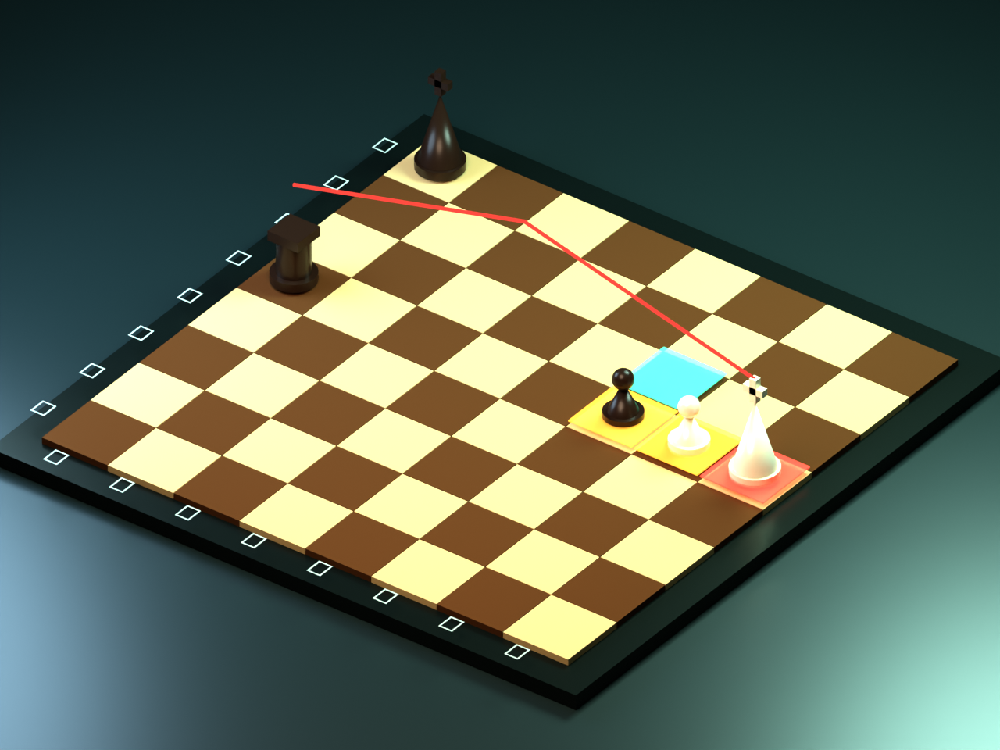
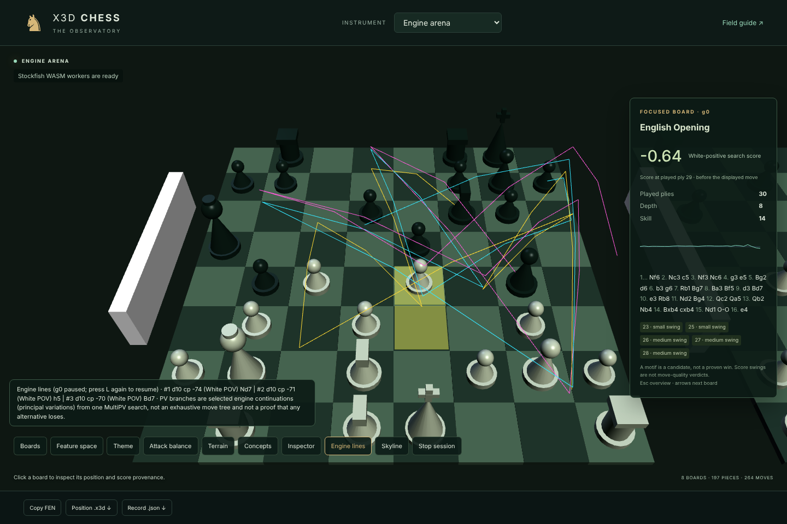
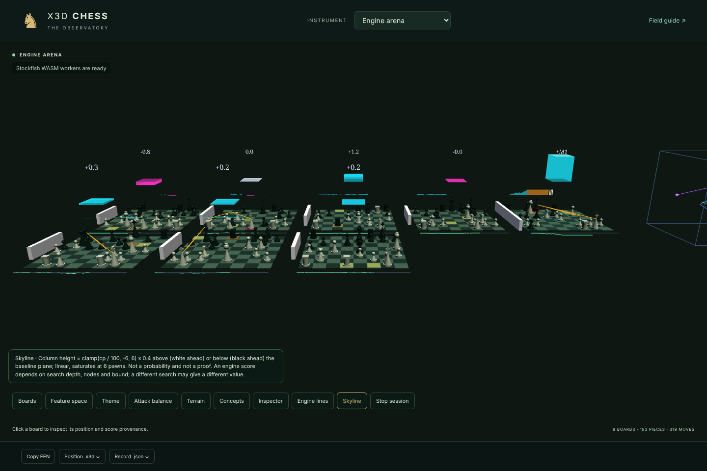

# X3D Chess Observatory

An AI-vs-AI arena and a small laboratory for visual chess reasoning. Boards,
pieces, attack relations, highlights, graphs and feature-space trails are X3D
geometry driven through X_ITE's Scene Access Interface.

The current enhancement pass extends `66b9d5d6fd0f0ef18bf4d9a7ef106154d9fc9700`.
Choose **Detail → Analyst** for an instrument desk beside the X3D viewport:
material and mobility, pawn topology and king rings, a numerical 64-square
control matrix linked to X3D inspection, and a bounded engine search workspace.
Pieces have sculpted silhouettes; focused cameras include overhead and Black-side views.

[Critical review and roadmap](docs/VISUAL-ANALYSIS-REVIEW.md) ·
[Field guide](viewer/guide.html) · [Integration atlas](docs/INTEGRATION-ATLAS.md) ·
[Runtime evidence and limits](docs/RUNTIME-VALIDATION.md).

```bash
python3 run_chess.py
# http://127.0.0.1:8862/?engine=wasm&boards=4&depth=8&detail=analyst
# http://127.0.0.1:8862/?engine=study&detail=analyst
```

The original rule-study/reliability review extended baseline `dea017f`.
The historical Blender still below depicts that earlier piece set.



*Actual X3D import into Blender 5.2.4, not a native browser screenshot. All five
piece positions match the source FEN within the recorded tolerance. Studio
lighting/material adjustments and a bevel on the imported relation curve are
explicit; imported coordinate-label typography remains imperfect. See the
[receipt](evidence/blender-preview.json) and [script](tools/render_preview.py).*

## Run locally

Python's standard library is sufficient to serve the bundled viewer:

```bash
python3 run_chess.py --study --open
# http://127.0.0.1:8862/?engine=study

python3 run_chess.py --open
# http://127.0.0.1:8862/ — original twenty-board engine arena
```

On Windows, use `py -3 run_chess.py --study --open`. An ordinary HTTP server
serving `viewer/` also works. Use localhost or HTTPS: study verification uses
Web Crypto. Browser assets, fonts, chess.js and the Stockfish loader/WASM are
local; no CDN or npm installation is needed to run. Fresh Windows/WSL and
native browser graphics checks remain to be run by users.

| URL query | Instrument |
| --- | --- |
| `?engine=study` | Four rule experiments on one board; no engine search |
| `?boards=4&depth=8&pool=2` | Four games sharing two actual Stockfish Workers |
| `?engine=replay&boards=4` | Explicitly labeled legal replay with material proxy |
| `?engine=sse&server=http://127.0.0.1:8080/events` | Python/native UCI server |
| `?boards=20&heat=1&theme=moss` | Attack-count balance with the low-glare palette |

Board counts 1–64 use one layout specification for PROTO instances, piece
positions and cameras. This supported configuration range is not a measured
performance promise. Query options are bounded. No mode silently substitutes
replay when engine initialization fails.

Controls: select a board; Esc returns to overview; arrows select adjacent
boards; T cycles themes; H toggles attack balance. Form controls retain normal
keyboard behavior. Reduced motion is respected. The study room has explicit
reset, undo and counterfactual controls.

## Lenses: 3D evaluation and advanced concepts

Five opt-in overlays (terrain `G`, concepts `C`, inspector `I`, engine lines `L`, skyline `K`) turn the arena into a place to ask why. Each carries its own legend and a test against an independent oracle. See [docs/LENSES.md](docs/LENSES.md).

**Chess960 (Fischer Random):** header RULES selector, `?variant=960[&pos=0-959]`, or `--variant 960` on the server. 960 castling is implemented here (chess.js has none) and checked ply-by-ply against python-chess. See [docs/CHESS960.md](docs/CHESS960.md).




## Four ways to see a rule

| Experiment | Intervention | Insight |
| --- | --- | --- |
| Pinned is not powerless | Move the pinning rook off the e-file | A pinned knight still attacks a square forbidden to the enemy king. |
| The capture that opens a rank | Move the rook from a5 to a4 | En passant removes two fifth-rank blockers, exposing the king in one variant. |
| When a queen brings a draw | Compare Q/R/B/N promotion on c8 | Queen stalemates; rook leaves a legal reply; bishop/knight produce insufficient material in this fixture. No forced-win claim is made. |
| The square the king must cross | Move the black rook from f8 to a8 | Castling checks the transit square as well as start and destination. |

The catalog has **7 source positions and 16 move probes**. Python-chess produces
saved witnesses; independent chess.js controls check full legal move sets,
terminal predicates, attack/pin queries and resulting positions. Manual
known-answer assertions and damaged twins supplement implementation agreement.
The browser verifies catalog bytes before using them. Data and source
references: [viewer/data/](viewer/data/) and [tools/build_studies.py](tools/build_studies.py).

The toolbar exports FEN, an observation JSON, and static portable X3D. The latter
contains named piece occupancy, the selected palette, coordinate labels, study
relations and scoped metadata. It explicitly omits X_ITE's `Shape.pointerEvents`
extension. It does not serialize Workers, animation or repetition history.
Seven examples are in [examples/x3d/](examples/x3d/).

## What the review changed

| Area | Result |
| --- | --- |
| Chess analysis | Correct absolute pins, legal discovery witnesses, honest geometric candidates; unsupported overload claims removed; score swings have neutral names. |
| Score meaning | Pre-move FEN/ply and White-positive perspective retained. Null stays unavailable, mate is typed, bounds explicit. Unavailable scores hide the visual bar. |
| Engine transport | Waiters precede sends; timeouts/cancellation/failed leases recover; stop rejects pending jobs; opening and played history reach UCI. |
| Server/SSE | Legal engine moves, initial snapshots after initialization, complete reconnect state, bounded slow-client handling, engine retirement/replacement. |
| Render state | One runtime layout, recoverable async queues, generation/sequence gates, single-flight overlays, stale-work rejection, visible reset/disposal. |
| Visual semantics | Attack-count balance and a clipped three-feature map explained as heuristics. Motifs are candidates, not proven wins. |
| Reproducibility | Pinned local runtime bytes, actual full XSD/semantic instrument, runtime-fragment captures, independent rule controls and real WASM searches. |

Browser auto-claims apply only to the current reached position
(`claim_current_position`). Python's `claim_available` also permits prospective
claims supported by python-chess. Claims and spectator caps are explicitly
adjudicated; mandatory endings are separate. FEN alone cannot recover repetition
history. [Protocol](docs/PROTOCOL.md) gives exact interfaces and policies.

## Verification

Use an isolated Python environment (tested here with Python 3.12 and Node 24):

```bash
python3 -m venv .venv
# Linux/WSL: source .venv/bin/activate
# Windows:  .venv\Scripts\activate
python -m pip install -r server/requirements-dev.txt -r tools/requirements-validation.txt
npm test
```

`CHESS_TEST_PYTHON` chooses a Python executable when needed. The aggregate check
records commands and source identities in [evidence/integration-check.json](evidence/integration-check.json).
It runs Node controls, independent parity, the full Python suite normally and
with `-O`, actual Stockfish WASM/UCI searches, runtime XML captures, seven
exports, and XSD/implemented semantic checks. Missing dependencies, stale parity
producers or skipped Python cases fail the check.

Native browser execution is separate:

```bash
npm install --no-save playwright
npx playwright install chromium
node tools/smoke.mjs
# optional: QUERY='?engine=wasm&boards=4&depth=8' node tools/smoke.mjs
```

**This environment blocks Chromium's socket initialization.** The browser
receipt says `not_run`. No fresh native X_ITE pixels, browser Worker startup,
FPS, GPU performance, picking or accessibility audit is inferred from Node,
mock-SAI, schema or Blender checks. Previous figures in
[docs/RESULTS.md](docs/RESULTS.md) are historical.

The XSD adapter uses the pinned, unchanged public `x3d_mcp` subset in `vendor/`.
It uses actual schemas, including XML signature definitions; the old stub is
removed. XSD 4.0 and the validator's implemented 4.1 semantic vocabulary are
recorded separately. Their agreement is not a complete proof of the spec.

## Optional Python engine server

```bash
python -m pip install -r server/requirements.txt
cd server
python -m x3dchess_server.server --engine /path/to/stockfish --boards 20 --pool 4 --depth 14
```

Then select UCI server in the viewer. See [server review](docs/SERVER-REVIEW.md)
for reliability policy and supported GET endpoints. The supplied launcher is
for local study.

## Extend with evidence

[INTEGRATION-ATLAS.md](docs/INTEGRATION-ATLAS.md) and
[ONTOLOGY.json](docs/ONTOLOGY.json) collate prioritized work and reusable hooks
for MathLab, STEM, ML, demos, documentation and Flywheel. Next steps include
native browser acceptance, measured scaling, inspectable square attackers/legal
moves, equal-budget MultiPV comparisons, and proof-bearing tactical studies.
None is represented as already implemented.

Technical contracts: [analysis](docs/ANALYSIS-FIDELITY.md),
[renderer](docs/RENDERER-CONTRACT.md), [transport](tools/transport-review.md),
[runtime](docs/RUNTIME-VALIDATION.md). Attribution and licenses:
[docs/ATTRIBUTION.md](docs/ATTRIBUTION.md), [vendor/](vendor/),
[viewer/vendor/](viewer/vendor/).

GPL-3.0-or-later. Based on the owner's chess-spectator port; see [LICENSE](LICENSE).
